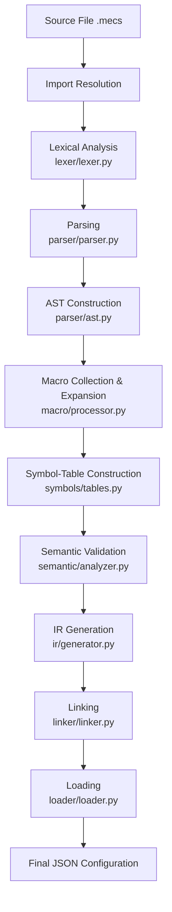

# MECSL Architecture

## Pipeline



---

## Module Responsibilities

| Module                  | Input             | Output                        |
|-------------------------|-------------------|-------------------------------|
| `source.py`             | —                 | `SourceSpan` dataclass        |
| `diagnostics.py`        | —                 | `DiagnosticBag`, `Diagnostic` |
| `lexer/token.py`        | —                 | `TokenKind`, `Token`          |
| `lexer/lexer.py`        | source `str`      | `list[Token]`                 |
| `parser/ast.py`         | —                 | AST node dataclasses          |
| `parser/parser.py`      | `list[Token]`     | `ProgramNode`                 |
| `macro/processor.py`    | `ProgramNode`     | expanded `ProgramNode`        |
| `symbols/tables.py`     | `ProgramNode`     | `SymbolTable`                 |
| `semantic/analyzer.py`  | `ProgramNode`+`SymbolTable` | diagnostics      |
| `ir/instruction.py`     | —                 | `Instruction`, `LinkedModule` |
| `ir/generator.py`       | `ProgramNode`     | `list[Instruction]`           |
| `linker/linker.py`      | `dict[str, list[Instruction]]` | `LinkedModule` |
| `loader/loader.py`      | `LinkedModule`    | `dict` (config + scripts)     |
| `pipeline.py`           | entry file path   | orchestrates all phases       |
| `cli.py`                | CLI args          | formatted output / exit code  |

---

## Data Models

### SourceSpan
```python
@dataclass(frozen=True)
class SourceSpan:
    file: str
    start_line: int
    start_column: int
    end_line: int
    end_column: int
```

### Token
```python
@dataclass
class Token:
    kind: TokenKind   # enum
    lexeme: str       # raw text
    value: Any        # parsed Python value (int, str, bool, or None)
    source_span: SourceSpan
```

### AST Nodes (key ones)
- `ProgramNode` — root; holds `list[StatementNode]`
- `SectionNode` — `name: str`, `body: list[AssignmentNode]`
- `AssignmentNode` — `target: list[str]`, `value: ValueNode`
- `MacroDefinitionNode` — `name`, `parameters`, `body`
- `MacroCallNode` — `name`, `arguments`
- `ScriptNode` — `name`, `body: list[PrintNode | RunNode]`

### Instruction
```python
@dataclass
class Instruction:
    opcode: Opcode         # MODULE_BEGIN, SET_VALUE, etc.
    operands: list[Any]
    module: str
    source_span: SourceSpan
```

### LinkedModule
```python
@dataclass
class LinkedModule:
    name: str
    instructions: list[Instruction]
    export_table: dict[str, Any]   # qualified_name -> value (filled by loader)
```

---

## Phase I/O Summary

1. **Lexer** — `str` → `list[Token]`
2. **Parser** — `list[Token]` → `ProgramNode`
3. **MacroProcessor** — `ProgramNode` → expanded `ProgramNode` (defs removed, calls inlined)
4. **SymbolTable** — expanded `ProgramNode` → queryable symbol registry
5. **SemanticAnalyzer** — expanded `ProgramNode` + `SymbolTable` → diagnostics
6. **IRGenerator** — expanded `ProgramNode` → `list[Instruction]`
7. **Linker** — `dict[module_name → instructions]` → `LinkedModule`
8. **Loader** — `LinkedModule` → `{"config": {...}, "scripts": {...}}`
